 

## 🧑‍💻 Sobre mí

Desarrollador **backend** que construye **APIs y servicios** con **Python y Flask/FastAPI**, y diseña y optimiza **bases de datos** con **SQL, PL/SQL y PostgreSQL**. Me apasiona integrar **Inteligencia Artificial** en soluciones reales y automatizar procesos para que los equipos trabajen mejor.

- 🔭 **Ahora:** microservicios serverless y automatización con IA
- 🌱 **Aprendiendo:** agentes de IA y Claude Code
- 🤝 **Abierto a:** colaborar en proyectos backend
- ⚡ **Lema:** todos los días se aprende algo nuevo

🌎 <b>About me (English)</b>

 

**Backend developer** building **APIs and services** with **Python and Flask/FastAPI**, and designing and optimizing **databases** with **SQL, PL/SQL and PostgreSQL**. I'm passionate about bringing **AI** into real-world solutions and automating processes so teams can work smarter.

- 🔭 **Now:** serverless microservices & AI automation
- 🌱 **Learning:** AI agents & Claude Code
- 🤝 **Open to:** collaborating on backend projects

## 💼 En qué trabajo ahora

Desarrollo backend en el sector **financiero · crédito y cartera**:

| | |
|---|---|
| ⚙️ **Microservicios serverless** | AWS Lambda + Python (FastAPI) con **arquitectura hexagonal**, pruebas automatizadas y calidad con SonarQube |
| 🔄 **Modernización** | Migración de servicios legacy (Python + Oracle) a la nueva arquitectura |
| 🗄️ **Bases de datos** | Lógica de negocio en **Oracle PL/SQL**: paquetes, procedimientos y consultas |
| 📈 **Simulación financiera** | Simulador de tasas y planes de amortización con validación de políticas de crédito |
| 🔗 **Integraciones** | Conexión con proveedores externos para pagos y cargue de información |
| 🖥️ **Frontend interno** | Funcionalidades en un panel administrativo en Angular (TypeScript) |
| 🤖 **IA en el desarrollo** | Claude Code con skills, agentes y un agente de QA |
| 🚀 **CI/CD** | GitHub Actions, Jenkins y Docker |

🌎 <b>What I'm working on (English)</b>

 

Backend development in the **financial · credit & collections** sector: serverless microservices on **AWS Lambda** with **Python (FastAPI)** and **hexagonal architecture**, **legacy modernization**, **Oracle PL/SQL** business logic, an **interest-rate & amortization simulator**, third-party **integrations**, an **Angular** admin panel, and **AI-assisted development** with Claude Code.

## 🛠️ Tecnologías

<table>
  <tr>
    <td align="center" width="140"><b>Backend</b></td>
    <td></td>
  </tr>
  <tr>
    <td align="center"><b>Bases de datos</b></td>
    <td>&nbsp;</td>
  </tr>
  <tr>
    <td align="center"><b>Frontend</b></td>
    <td></td>
  </tr>
  <tr>
    <td align="center"><b>Cloud y DevOps</b></td>
    <td>&nbsp;</td>
  </tr>
  <tr>
    <td align="center"><b>IA y herramientas</b></td>
    <td>&nbsp;</td>
  </tr>
</table>

## 🚀 Proyectos destacados

| Proyecto | Qué es | Stack |
|---|---|---|
| 📚 [**biblioteca-fullstack**](https://github.com/JuanB12/biblioteca-fullstack) | Sistema de préstamos y reservas con JWT, correos e integración con Open Library | `Java 21` `Spring Boot` `PostgreSQL` `React` `Docker` |
| 🐍 [**ParcialPythonAnywhere**](https://github.com/JuanB12/ParcialPythonAnywhere) | API de solicitudes de vehículos y viajes, desplegada en PythonAnywhere | `Python` `Flask` |
| 🏠 [**PleasedHome**](https://github.com/JuanB12/PleasedHome) | Plataforma para contratar servicios domésticos y cuidado de niños | `TypeScript` `Next.js` `Tailwind` |
| 🤖 [**Cookie_Cravings**](https://github.com/JuanB12/Cookie_Cravings) | Chatbot con IA para atención al cliente de una tienda de galletas | `Dialogflow` `JavaScript` |
| 🗄️ [**activityBdVentas**](https://github.com/JuanB12/activityBdVentas) | Base de datos de ventas: clientes, comerciales y pedidos | `SQL` |
| 🦷 [**Odontograma**](https://github.com/JuanB12/Odontograma) | Registro dental digital para documentar la salud bucal de pacientes | `HTML` `SCSS` `JavaScript` |

## 📊 Estadísticas

 

